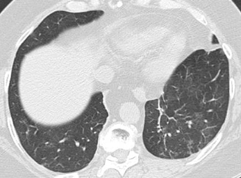
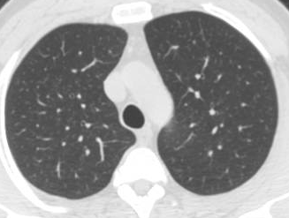
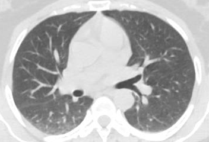
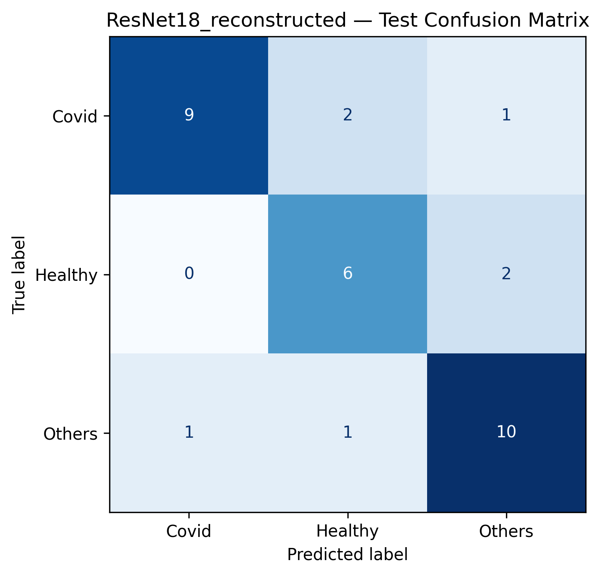
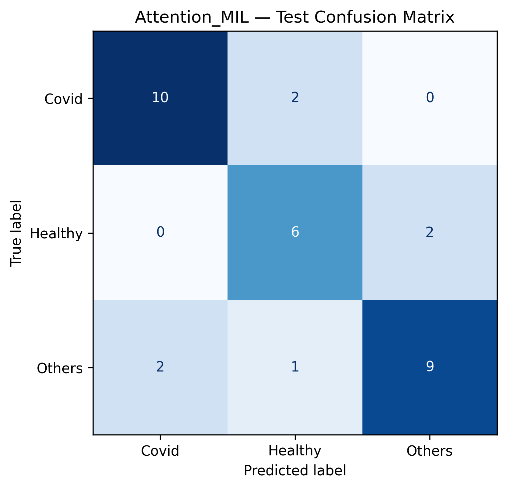
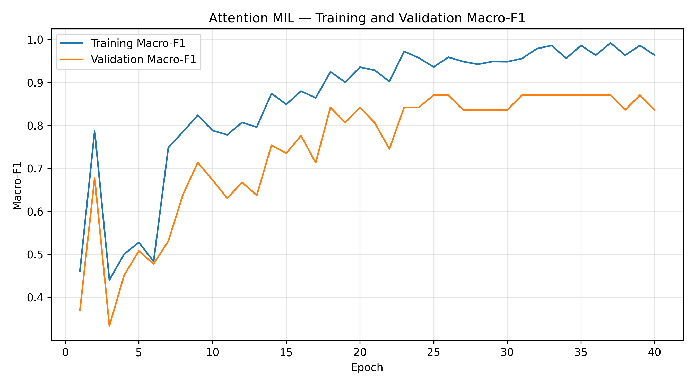
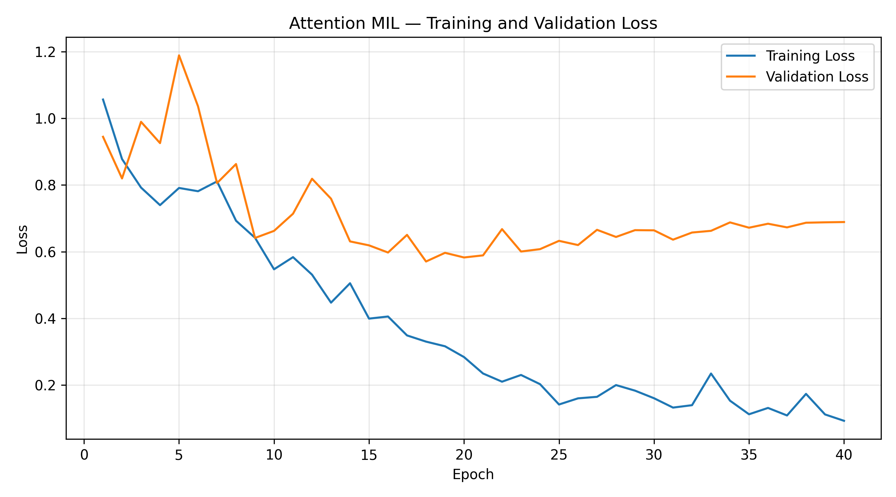

# Chest CT Scan Classification using Deep Learning

<p align="center">
  <b>Multi-class chest CT image classification using Transfer Learning and Attention-Based Multiple Instance Learning (MIL).</b>
</p>

<p align="center">
  
  
  
  
</p>

---

## Project Overview

This project explores deep learning approaches for classifying chest CT scan images into three categories:

- **COVID-19**
- **Healthy**
- **Other pulmonary conditions**

The pipeline uses transfer learning with a pretrained ResNet-18 model and extends it with an attention-based Multiple Instance Learning (MIL) architecture for patient-level classification.

The central idea is to move beyond classifying individual CT slices and investigate how information from multiple slices can be aggregated to produce a patient-level prediction.

## CT Scan Samples

Example images from the three dataset categories:

<p align="center">
  
  
  
</p>

<p align="center">
  <sub>COVID-19 · Healthy · Others</sub>
</p>

*These are sample images from the dataset, not diagnostic examples. Individual slices may not show all findings associated with their patient-level labels.*

## Project Architecture

```text
              Chest CT Scan Images
                       |
                       v
                Preprocessing
             Resize and Normalise
                       |
                       v
             ResNet-18 Feature Extraction
                       |
             512-D Slice Representations
                       |
                       v
             Attention-Based MIL
                       |
              Weighted Aggregation
                       |
                       v
              Patient-Level Classifier
                       |
                       v
             3-Class Prediction
       COVID-19 | Healthy | Others
```

## Dataset

The project uses the publicly available **SARS-CoV-2 CT Scan Dataset** by Soares and Angelov.

**Source:** [Harvard Dataverse – SARS-CoV-2 CT Scan Dataset](https://doi.org/10.7910/DVN/SZDUQX)

The dataset contains 4,171 PNG CT images organised into 210 patient folders.

| Class | Patient folders | Images |
|---|---:|---:|
| COVID-19 | 80 | 2,167 |
| Healthy | 50 | 757 |
| Others | 80 | 1,247 |
| **Total** | **210** | **4,171** |

### Dataset Preparation

- Audited image dimensions, file integrity and class distribution.
- Identified duplicate images using image hashing.
- Excluded two duplicate images from the modelling manifest.
- Retained 4,169 images for model development.
- Created training, validation and test splits at the patient-folder level to prevent images from the same folder appearing across different splits.

**Patient identity caveat:** Patient identifiers were constructed using class-qualified folder paths. Their correspondence to unique real-world patient identities across classes has not been independently verified.

## Methodology

### 1. Data Preprocessing

- Resized images to 224 × 224 pixels.
- Converted images to RGB.
- Applied ImageNet normalisation.
- Used random rotation for training augmentation.
- Implemented PyTorch Dataset and DataLoader pipelines.

### 2. Transfer Learning with ResNet-18

A pretrained ResNet-18 model was used as the baseline architecture.

- Loaded pretrained ImageNet weights.
- Initially froze the feature extraction layers.
- Replaced the final fully connected layer with a three-class classifier.
- Used class-weighted Cross Entropy Loss to address class imbalance.
- Fine-tuned the final ResNet layer using differential learning rates.
- Used Adam optimisation, learning-rate scheduling and early stopping.

### 3. Attention-Based Multiple Instance Learning

The project was extended to patient-level classification using an attention-based MIL architecture.

- Each patient is represented as a bag of CT image slices.
- A frozen ResNet-18 feature extractor generates a 512-dimensional representation for each slice.
- An attention mechanism learns the relative importance of individual slices.
- Weighted feature aggregation produces a patient-level representation.
- A classification head predicts one of the three classes.

The attention mechanism provides slice-level weights indicating the relative contribution of each slice to the patient-level prediction.

**Implementation note:** The ResNet-18 feature extractor was trained using slice-level labels before being used in the MIL pipeline. This is a transfer-learning-based MIL implementation.

## Results

### Patient-Level Model Comparison

Both models were evaluated on the same held-out test set of 32 patient folders.

| Metric | ResNet-18 | Attention MIL |
|---|---:|---:|
| Accuracy | 78.13% | 78.13% |
| Macro F1-score | 0.7747 | 0.7739 |

The two approaches achieved comparable performance on the test set. Attention MIL provides a patient-level aggregation mechanism, while ResNet-18 serves as the transfer-learning baseline.

### Attention MIL — Class-wise Performance

| Class | Precision | Recall | F1-score |
|---|---:|---:|---:|
| COVID-19 | 0.83 | 0.83 | 0.83 |
| Healthy | 0.67 | 0.75 | 0.71 |
| Others | 0.82 | 0.75 | 0.78 |

- Accuracy: 78.13%
- Macro F1-score: 0.7739
- Test set: 32 patient folders

## Results & Visualisations

### ResNet-18 Confusion Matrix



### Attention MIL Confusion Matrix



### MIL Training Performance

**Macro F1-score**



**Training and validation loss**



### Additional Evaluation Files

- [Model Comparison](results/final_project_results/model_comparison.csv)
- [Patient-Level Comparison](results/final_project_results/patient_level_comparison.csv)
- [Final Metrics](results/final_project_results/final_metrics.json)
- [Experiment Summary](results/final_project_results/project_experiment_summary.json)
- [MIL Attention Weights](results/final_project_results/mil_attention_weights.csv)

## Interpretability and Error Analysis

The project also explores model interpretability and prediction errors.

- Used Grad-CAM with ResNet-18 to visualise regions contributing to model activations.
- Examined attention weights assigned to individual CT slices by the MIL model.
- Compared correct and incorrect patient-level predictions.
- Investigated high-confidence misclassifications and differences between the two architectures.

Attention weights represent relative slice contributions within a patient bag. They are not pixel-level explanations or clinical evidence.

## Technology Stack

| Category | Tools |
|---|---|
| Programming | Python |
| Deep Learning | PyTorch, Torchvision |
| Data Processing | NumPy, Pandas |
| Image Processing | PIL |
| Evaluation | Scikit-learn |
| Visualisation | Matplotlib, Seaborn |
| Environment | Google Colab, Google Drive |
| Version Control | Git, GitHub |

## Repository Structure

```text
Chest-CT-Classifier/
│
├── assets/
│   └── ct_samples/
│       ├── covid_sample.png
│       ├── healthy_sample.png
│       └── others_sample.png
│
├── notebooks/
│   └── chest_ct_classifier.ipynb
│
├── results/
│   └── final_project_results/
│       ├── final_metrics.json
│       ├── model_comparison.csv
│       ├── patient_level_comparison.csv
│       ├── mil_attention_weights.csv
│       ├── mil_test_probabilities.npy
│       ├── resnet18_reconstructed_confusion_matrix.png
│       ├── attention_mil_confusion_matrix.png
│       ├── mil_f1_curve.png
│       ├── mil_loss_curve.png
│       └── project_experiment_summary.json
│
├── .gitignore
├── README.md
└── requirements.txt
```

## Limitations and Future Work

- The dataset is relatively small and imbalanced.
- Patient-level evaluation is based on 32 held-out patient folders.
- Patient identity assumptions based on folder naming require further verification.
- The current pipeline uses 2D CT slices rather than full 3D CT volumes.
- The models may learn dataset-specific patterns and require external validation.
- Grad-CAM and attention weights do not establish clinical interpretability.

### Potential Improvements

- Experiment with EfficientNet and other pretrained architectures.
- Explore 3D CNN-based CT classification.
- Investigate stronger patient-level aggregation methods.
- Perform external validation on an independent dataset.
- Improve interpretability and robustness analysis.

## Disclaimer

This project is developed for educational and research purposes only. It is not a clinically validated diagnostic system and must not be used for medical diagnosis or treatment decisions.

---

**A deep learning project exploring transfer learning, medical image classification and attention-based patient-level learning.**
